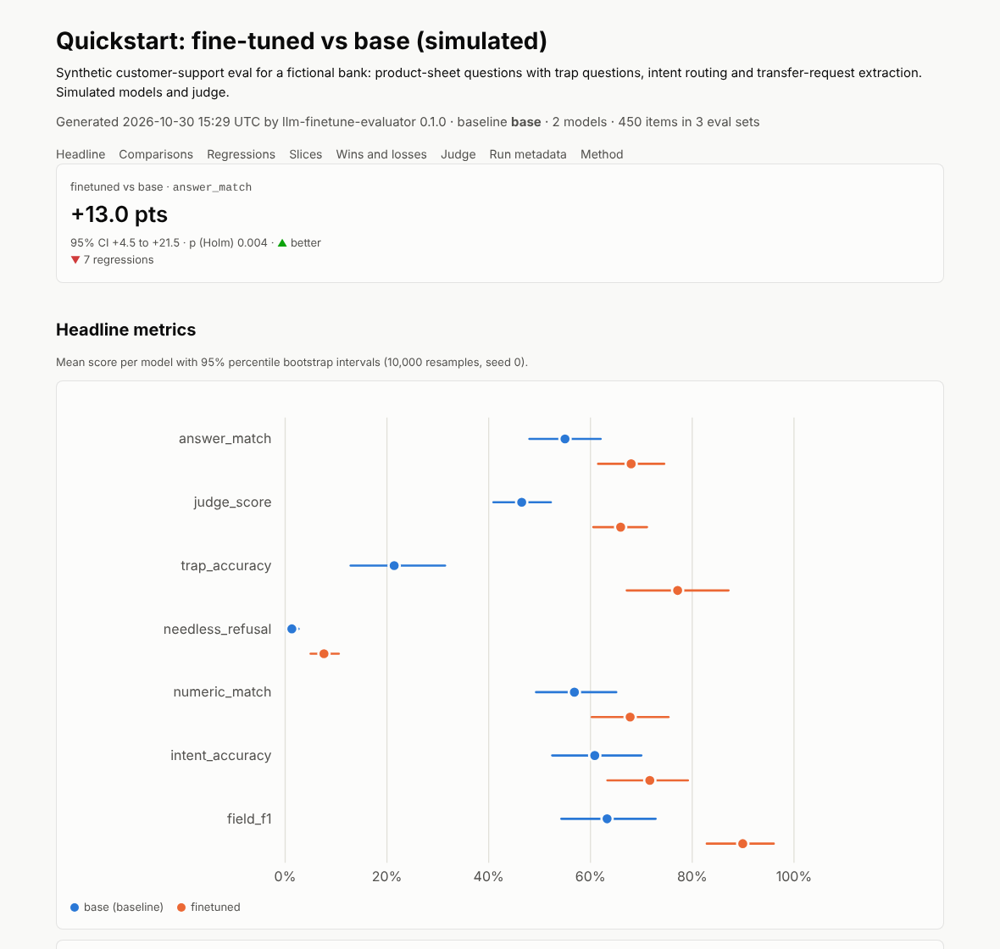

# llm-finetune-evaluator

[](https://github.com/Hedmm/llm-finetune-evaluator/actions/workflows/ci.yml)


**Is your fine-tuned LLM actually better than the base model or another
checkpoint, and where does it get worse?**

`lfe` runs every model on the same eval set, scores every answer and compares
the models item by item. You get confidence intervals, exact paired tests,
regressions per slice after correcting for multiple comparisons, trap questions
that catch made-up answers, a count of needless refusals, and an LLM judge that
is checked against human labels before you trust it. Every run ends in a
Markdown report and a self-contained HTML report.



## Why paired statistics

200 questions. The base model answers 140 correctly (70%), the fine-tune 150
(75%). Is the fine-tune better?

| | Fine-tune correct | Fine-tune wrong |
|---|---|---|
| **Base correct** | 138 | 2 |
| **Base wrong** | 12 | 48 |

Treated as two independent samples, the five-point gap is not significant: a
two-proportion z-test gives p = 0.26. But both models answered the *same*
questions, and they agree on 186 of them. On the 14 where they disagree, the
fine-tune wins 12 and loses 2; if the models were equally good that would be
like 12 heads in 14 coin flips. The exact McNemar test gives p = 0.013, and the
paired bootstrap interval for the difference is +1.5 to +8.5 points.

Same data, opposite conclusion. Models agree on which items are easy, so
comparing them item by item removes most of the noise. `lfe` does this for
every metric and every slice, and reports the minimum detectable effect next
to every "no significant difference", so a too-small eval set is never mistaken
for a tie. More in [docs/paired-tests.md](docs/paired-tests.md).

## Quickstart (offline, no GPU)

```bash
git clone https://github.com/Hedmm/llm-finetune-evaluator
cd llm-finetune-evaluator
python -m venv .venv
source .venv/bin/activate
pip install -e ".[dev]"
lfe run examples/mock_quickstart/config.yaml
lfe report runs/mock_quickstart
```

Open `runs/mock_quickstart/report.html` (a copy is in
[docs/sample-report.html](docs/sample-report.html)). The run and the report take
a few seconds: the quickstart uses the `mock` backend, which simulates two
models with known skill profiles on 450 synthetic support items, and a
simulated judge.

The fine-tune in the quickstart was set up to be better overall but worse on
loan questions and quicker to refuse. The report finds exactly that:

- answer match +13.0 points (55.0% to 68.0%, Holm p = 0.004) and trap accuracy
  21.4% to 77.1%;
- needless refusals up from 1.3% to 7.6% (flagged as a regression);
- on `topic=loans` answer match −30.0 points, also flagged, on 40 items;
- the simulated judge agrees with the labelled sample with Cohen's kappa 0.90,
  so the judge-based scores are marked reliable.

## Evaluate your own models

Write an eval set ([format](docs/eval-set-format.md)) and a config
([reference](docs/configuration.md)). A base model against its LoRA adapter,
both served by vLLM:

```bash
vllm serve Qwen/Qwen2.5-1.5B-Instruct --enable-lora --lora-modules support-lora=./adapter
```

```yaml
name: support-bot
eval_sets:
  - name: heldout
    path: data/heldout.jsonl
models:
  - name: base
    backend: openai
    model: Qwen/Qwen2.5-1.5B-Instruct
    base_url: http://localhost:8000/v1
  - name: finetuned
    backend: openai
    model: support-lora
    base_url: http://localhost:8000/v1
scorers:
  - type: normalized_match
    mode: contains
  - type: trap
  - type: refusal
  - type: judge
judge:
  model:
    backend: openai
    model: llama3.1:8b                    # a different model family
    base_url: http://localhost:11434/v1   # served by ollama
```

```bash
lfe run config.yaml --dry-run     # validate everything, call no model
lfe run config.yaml
lfe report runs/support-bot
```

With ollama, use `base_url: http://localhost:11434/v1` and the ollama model
tags; with the llama.cpp server, `http://localhost:8080/v1`. Other backends:
local `transformers` models with optional PEFT/LoRA adapters
(`pip install -e ".[transformers]"`), `replay` for predictions you already
have, and OpenAI itself. See [docs/backends.md](docs/backends.md).

Generations are cached on disk, keyed by model, prompt and sampling
parameters, so re-running, adding a scorer or regenerating a report costs
nothing. Requests run concurrently and transient errors are retried with
exponential backoff.

## What is measured

| Scorer | For | What it reports |
|---|---|---|
| `exact_match`, `normalized_match` | classification, short answers | Match after trimming, or after case, punctuation and article normalisation; `contains` mode for answers inside a sentence |
| `label_set` | classification | Accuracy over a closed label set; off-list answers are counted as invalid labels |
| `json_fields` | extraction | Field-level precision, recall and F1 of the JSON object |
| `numeric` | numbers | The number in the answer is within an absolute or relative tolerance |
| `regex` | format checks | The answer matches a pattern, fixed or per item |
| `trap` | trap and refusal_expected items | Abstaining is correct; a confident answer is labelled `made_up` (or `complied`) |
| `refusal` | answerable items | Needless refusals (lower is better) |
| `judge` | free-form answers | Rubric grade from a separate judge model: correct, partially correct, incorrect, refused, made up |

Every metric is reported per model with a confidence interval, compared between
all model pairs, and broken down by every tag of the eval set (`topic`,
`difficulty`, `source`, ...) as well as by task and eval set.

## Statistics in brief

- 95% percentile bootstrap intervals (10,000 resamples), seeded per
  computation, so every number in a report is reproducible.
- Exact McNemar test for 0/1 metrics; paired permutation test for continuous
  ones (exact whenever the scores lie on a grid).
- Holm–Bonferroni correction across model pairs, and across the slices of each
  candidate; regressions are slices that are significantly worse after it.
- Minimum detectable effect for every comparison and `lfe mde` for sizing an
  eval set ([docs/sizing-eval-sets.md](docs/sizing-eval-sets.md)).
- Runs are compared only when their eval sets have the same content hash.

All of it lives in [`stats.py`](src/llm_finetune_evaluator/stats.py), with
tests against SciPy, scikit-learn and the p-values published in the case study.

## The LLM judge, calibrated

The judge grades one answer at a time, never sees model names, and runs at
temperature 0; `lfe` warns when it is from the same model family as an
evaluated model. Before its scores count, compare it with people:

```bash
lfe judge-calibrate config.yaml --export-template to_label.jsonl --size 80
lfe judge-calibrate config.yaml --labels to_label.jsonl
```

This reports agreement, Cohen's kappa with a confidence interval and the
confusion matrix. When kappa is below 0.6, `lfe` prints a warning and every
report marks the judge-based metrics as unreliable. Why kappa and not
agreement, and what else can go wrong with judges:
[docs/llm-judges.md](docs/llm-judges.md).

## Commands

| Command | What it does |
|---|---|
| `lfe run CONFIG` | Generate and score with every model; `--dry-run`, `--model NAME`, `--no-cache`, `--report` |
| `lfe compare RUN_A RUN_B` | Paired comparison of two runs in the terminal |
| `lfe report RUNS_DIR` | Markdown, HTML and JSON reports; `--baseline`, `--format`, `--alpha` |
| `lfe judge-calibrate CONFIG` | Judge against human labels; `--export-template` for a labelling sample |
| `lfe mde` | Minimum detectable effect or required number of items |

Every command has `--help` with examples. `lfe report` and `lfe compare` accept
`--fail-on-regression` and then exit with code 2 when a candidate is
significantly worse than the baseline anywhere, which turns an eval into a CI
gate for new checkpoints.

## Docker

```bash
docker build -t llm-finetune-evaluator .
docker run --rm llm-finetune-evaluator run examples/mock_quickstart/config.yaml --report
docker run --rm -v "$PWD:/work" -w /work --network host llm-finetune-evaluator run config.yaml
```

## Background: the case study

The statistics follow the
[LoRA vs QLoRA vs full fine-tuning case study](https://github.com/Hedmm/ml-case-studies/tree/main/lora-vs-qlora-vs-full-finetuning):
Qwen2.5-1.5B-Instruct fine-tuned on Banking77 with every other setting held
fixed, evaluated on 3,080 test messages with bootstrap intervals and exact
McNemar tests. There LoRA reached 92.1%, QLoRA 91.5%, full fine-tuning 85.1%
and the base model 36.3%.

[`examples/banking77`](examples/banking77) replays the case study's recorded
predictions on a 300-message slice with `lfe`: LoRA 92.7%, QLoRA 92.7%, full
fine-tuning 86.0% and the base model 37.7%. Full fine-tuning is significantly
worse than LoRA on the slice too (−6.7 points, 4 wins against 24 losses, Holm
p = 5.4e-04), but LoRA and QLoRA cannot be told apart: the minimum detectable
effect on 300 messages is ±2.9 points, far above the 0.65-point gap measured on
the full test set. The example also has a config for comparing two live
endpoints. [`examples/trap_questions`](examples/trap_questions) is a small
hand-written grounded-QA set with trap questions for local models in ollama.

## Development

```bash
pip install -e ".[dev]"
pytest
ruff check . && ruff format --check .
mypy
```

The test suite runs offline (it fails any test that opens a network
connection) and covers the statistics, every scorer, the cache, retries,
judge calibration, the reports and the command line. The transformers backend
tests build a tiny model locally and run when the `transformers` extra is
installed.

## License

MIT, see [LICENSE](LICENSE). The Banking77 slice in `examples/banking77` is
derived from Banking77 by PolyAI and licensed CC BY 4.0; see that example's
README for attribution.
